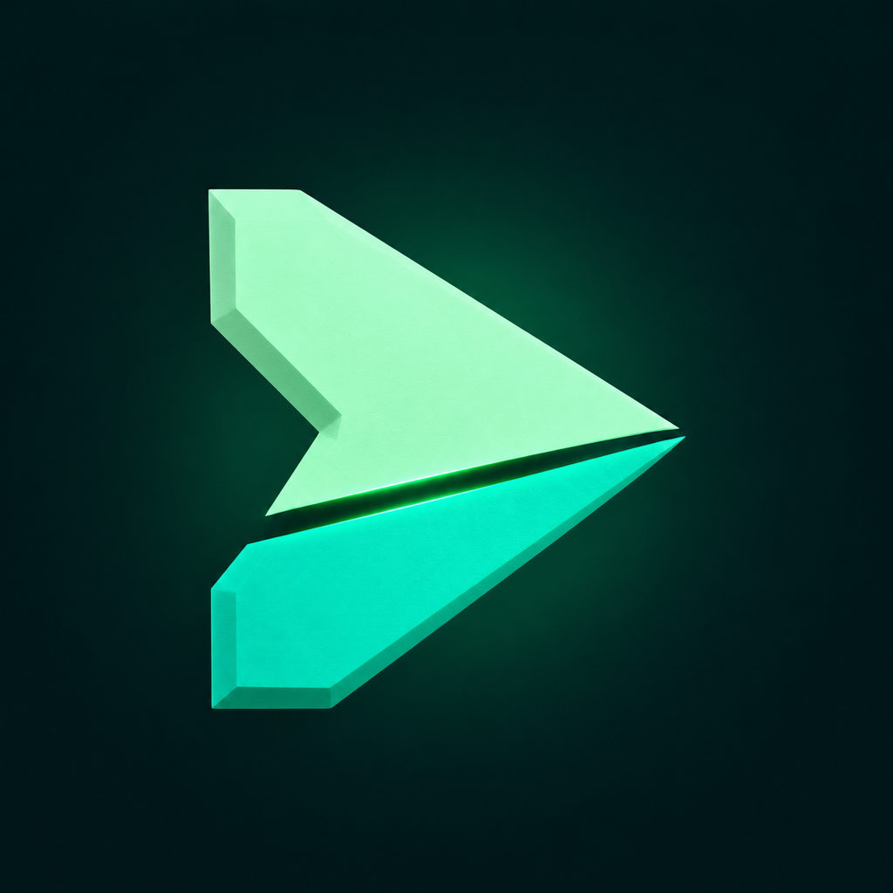
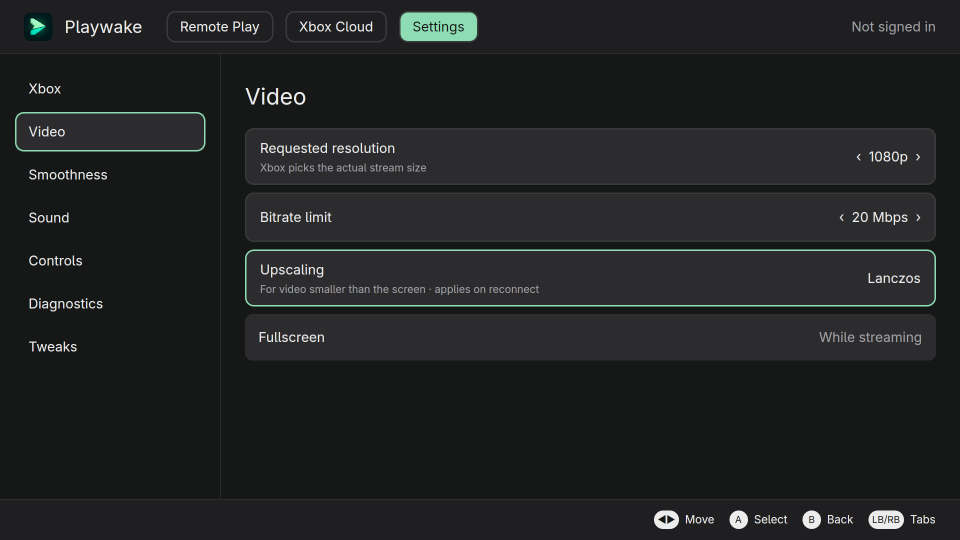

<p align="center">
  
</p>

<h1 align="center">Playwake</h1>

<p align="center">
  A native Xbox Remote Play and Xbox Cloud Gaming client for SteamOS and Linux.
</p>

<p align="center">
  <a href="https://github.com/beshkenadze/playwake/releases">Download for SteamOS</a>
  · <a href="#controls">Controls</a>
  · <a href="docs/development.md">Build from source</a>
</p>



## Install on SteamOS

1. In **Desktop Mode**, download `Playwake-steamos-x86_64.flatpak` from [GitHub Releases](https://github.com/beshkenadze/playwake/releases) and open it with **Discover**.
2. Open **Playwake** and sign in with Microsoft. Scan the QR code or open the sign-in page in your browser.
3. Choose a console under **Remote Play** or a title under **Xbox Cloud**. In desktop Steam, add **Playwake** as a non-Steam game to launch it from Gaming Mode.

You can also install and start the downloaded bundle from a terminal.

```sh
flatpak install --user ./Playwake-steamos-x86_64.flatpak
flatpak run io.github.beshkenadze.Playwake
```

The Flatpak uses the Freedesktop 26.08 runtime. Cloud Gaming availability depends on your Microsoft account, subscription, and region.

## Play your way

- **Remote Play.** Wake and stream from your Xbox. Enable auto-connect to start streaming when exactly one console is available.
- **Xbox Cloud Gaming.** Browse the cloud catalog and launch a title from its own tab.
- **PC games.** The **PC** tab finds PCs that run [Sunshine](https://github.com/LizardByte/Sunshine) on your network. Choose a PC to pair it: Playwake shows a PIN that you enter in the Sunshine web UI, once. After that the tab lists the PC's apps, and a stream plays in Playwake's own player with the same overlay, stats and controller handling as an Xbox stream. Playwake asks the PC for this device's resolution and refresh rate and uses the bitrate limit from its settings. Video is H.264 in SDR. On an HDR screen under Gamescope, such as the Steam Deck OLED, a PC that encodes 10-bit HEVC streams in HDR instead; **Settings → Video → HDR from a PC** turns that off. Before a start would end another app that the PC still runs, Playwake asks.
- **Fullscreen video.** Hardware decoding where available, configurable bitrate and resolution, Fit or Lanczos scaling, and optional Vulkan frame generation via [lsfg-vk](https://lsfg-vk.dev/).
- **Live diagnostics.** See the negotiated resolution, actual bitrate, decoded and presented FPS, available RTT, video delay, and separate network and client frame-drop counters.

## Controls

| Input | Action |
| --- | --- |
| **LB / RB** | Switch tabs |
| **D-pad / left stick** | Move focus. Press **Up** from the first row to reach the tabs |
| **A / B** | Select or go back |
| **View + Menu tapped together** | Open the Playwake stream overlay, with Xbox Guide, statistics, reconnect and end stream |

Tap both buttons at the same time; there is no need to hold them. The stream shows the overlay shortcut when it starts. On desktop, you can also right-click the video to open the overlay. See the [Linux setup guide](docs/development.md#lsfg-on-linux) for optional Lossless Scaling configuration.

## Project status

SteamOS and Linux x86-64 are the current release target. The Flatpak and live Xbox streaming have been tested on ROG Ally. Windows and macOS support is in development.

Playwake uses Rust, GPUI Kit and GStreamer. The media worker includes code developed alongside Greenlight. See the [MIT license and attribution](LICENSE).
